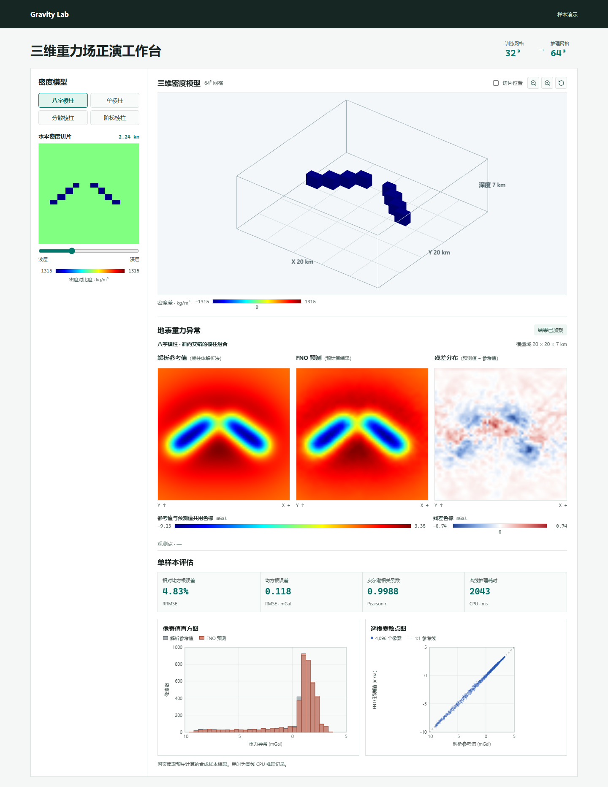
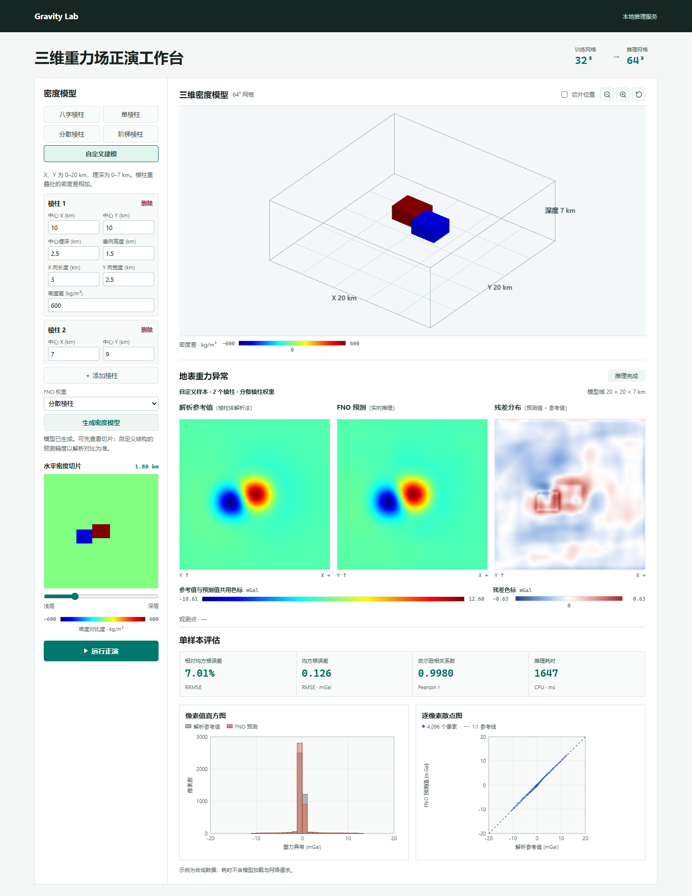

# 三维重力场正演工作台

输入是地下三维密度差模型，输出是地表重力异常图。工作台对比棱柱体解析参考值和傅里叶神经算子（FNO）的预测值，查看预测在不同空间位置的偏差。

## 实现方式

- **三维建模**　以 20 km × 20 km × 7 km 为模型域，用 64³ 网格表示密度差，重叠棱柱的密度差相加。Three.js 渲染三维模型，Canvas 显示可切换深度的水平切片。
- **解析正演与 FNO**　解析计算将各棱柱在同一地表观测点产生的垂向重力异常相加。Python 后端用 PyTorch 加载对应类别的 FNO 权重，将归一化的三维密度差和网格坐标送入模型，经谱卷积和深度聚合后生成 64 × 64 的地表预测。模型训练网格为 32³，演示使用 64³ 网格推理。
- **误差分析**　参考值与预测值共用色标。残差等于预测值减参考值，红色为正、蓝色为负、白色为零。页面展示像素值直方图、逐像素散点图、RMSE、相对 RMSE 和皮尔逊相关系数。四类样本各展示一个合成案例，指标对应各案例。

## 网页界面展示版

在 GitHub Pages 中切换八字棱柱、单棱柱、分散棱柱和阶梯棱柱，即可查看各样本的三维密度、解析参考值、FNO 预测及误差分析。支持拖动旋转、缩放、调节水平切片，以及查看热图观测点数值。网页以静态文件读取预先计算的结果，由浏览器绘图，无需联网调用计算后端。自定义建模与实时推理在 Windows EXE 中使用。

## Windows EXE

完整下载包内含 64 位 Windows 启动器、四类样本、FNO 权重和 CPU 推理环境。下载后解压，双击「三维重力场正演工作台.exe」。默认浏览器会打开工作台，计算由 EXE 启动的本机 Python 服务完成。使用时保持启动器运行。程序可离线使用，无需另装 Python 或配置模型权重。

支持对四类内置样本实时正演，也支持输入 1–16 个棱柱的中心位置、埋深、长宽高和密度差。生成模型后可查看解析参考值，再用选定的 FNO 权重进行预测。对自定义结构，可结合解析参考值判断预测误差。

网页由根目录的 HTML、CSS、JavaScript 和 `demo-data/` 组成。`backend/` 提供棱柱计算、FNO 推理、本机接口与静态演示数据导出源码。仓库保留运行逻辑和演示样本，模型权重随 Windows 下载包提供。
